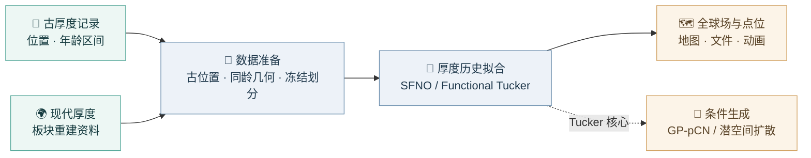

<h1 align="center">🌍 NORN · 诺恩</h1>

<p align="center"><strong>在动态板块几何下，重建 0–60 Ma 的全球地壳厚度历史。</strong></p>

<p align="center">
  
</p>

<p align="center">
  <a href="https://github.com/zhaorui-bi/NORN/actions/workflows/ci.yml"></a>
  <a href="pyproject.toml"></a>
  <a href="pyproject.toml"></a>
  <a href="pyproject.toml"></a>
  <a href="LICENSE"></a>
</p>

<p align="center">
  <a href="#quickstart">🚀 快速开始</a> ·
  <a href="#data-training">📦 数据与训练</a> ·
  <a href="#models">🧠 模型与生成</a> ·
  <a href="#inference">🗺️ 推理与导出</a> ·
  <a href="#validation">🧪 验证</a> ·
  <a href="#docs">📚 文档</a>
</p>

---

## 🧭 项目概览

NORN 将稀疏古厚度记录、现代厚度与逐年代板块几何结合，反演全球地壳厚度随时间的变化。默认采用年代条件球面神经算子 **SFNO**，并提供实验性的 **函数化 Tucker、GP 条件采样和潜空间扩散**。

**网格固定，大陆和板界随年代移动，厚度由模型预测。** 每个年代使用自己的几何输入 `X(a)`；古观测的年龄区间通过混合似然边缘化，样品位置在年龄节点重建。

| | 能力 | 实现 |
|---|---|---|
| 🌐 | 全球球面表示 | SFNO 与球面坐标因子，覆盖 0–60 Ma |
| ⏳ | 年代不确定性 | 保留年龄区间与积分节点，进行年龄边缘化拟合 |
| 🧩 | 动态板块几何 | 同龄大陆、板界距离与变形区覆盖作为条件输入 |
| 🎲 | 条件生成 | Tucker 核心上的 GP-pCN 与扩散观测引导，实验性 |
| 🔬 | 可比较实验 | 纯 ML 基线、显式物理一致性对照、冻结留出划分 |
| 📤 | 可追溯输出 | 独立 checkpoint、来源哈希、NPZ / DAT / NetCDF 与动画 |

> [!NOTE]
> **研究软件 Beta。** 真实资料当前标记为 `unverified_proxy`；默认输出点估计，条件采样区间尚未校准。合成实验用于验证软件与可控反演，真实地质精度仍需独立证据。详见[论文对照核查](docs/NORN_LITERATURE_AUDIT_CN.md)。



<a id="quickstart"></a>

## 🚀 快速开始

锁定环境支持 **Linux x86_64、Python 3.9–3.12**，默认 Python 3.11。环境由 [pyproject.toml](pyproject.toml) 与 [uv.lock](uv.lock) 统一管理。

### 1 · 安装 CPU 环境

```bash
# 已安装 uv 时，可跳过第一行
curl -LsSf https://astral.sh/uv/install.sh | sh

git clone https://github.com/zhaorui-bi/NORN.git
cd NORN
uv sync --locked --extra cpu --extra export --no-dev
source .venv/bin/activate
norn --version
```

<details>
<summary>🖥️ GPU 环境与可选依赖</summary>

CPU 与 CUDA 12.1 环境二选一；不要同时启用 `cpu`、`cuda`，也不要使用 `--all-extras`。

```bash
uv sync --locked --extra cuda --extra kinematics --extra export --extra viz --no-dev
source .venv/bin/activate
```

| 选项 | 用途 |
|---|---|
| `--extra cpu` / `--extra cuda` | PyTorch 与球面算子，使用各自的官方 PyTorch 索引 |
| `--extra kinematics` | pygplates，真实古位置与动态几何准备所需 |
| `--extra export` | xarray，用于 NetCDF 导出 |
| `--extra viz` | matplotlib，用于地图与动画 |

仅执行 `uv sync --locked --no-dev` 会安装基础数据依赖，不安装 PyTorch。无需激活环境时，可使用 `uv run --no-sync norn ...`。

</details>

### 2 · 从合成数据开始

以下命令在本地生成数据，并训练纯 ML 入门对照，无需下载真实观测或板块资料。

```bash
norn demo --output outputs/demo --device cpu
norn train --config outputs/demo/config.json --tag no_physics --output outputs/demo/run
norn infer --checkpoint outputs/demo/run/best.pt \
  --ages 0 13.4 30 60 --output outputs/demo/predictions \
  --device cpu --formats npz dat netcdf
norn evaluate --checkpoint outputs/demo/run/best.pt \
  --dataset outputs/demo/run/dataset.npz --split validation \
  --output outputs/demo/validation.json --device cpu
```

`demo` 同时生成物理自检资料；上面的 `--tag no_physics` 关闭其物理项。CUDA 环境可将 `--device cpu` 改为 `--device cuda`。

### 3 · 运行完整生成示例

```bash
uv run --no-sync python examples/generative_demo.py \
  --output outputs/generative_demo --device cpu
```

这个[完整示例](examples/generative_demo.py)比较现代参考、SFNO 与 Tucker，随后执行 **GP 采样 → 历史集合编码 → 扩散训练 → 观测引导 → 预测评估**。输出目录需为新目录；它使用独立解析合成历史。

<a id="data-training"></a>

## 📦 数据与训练

### 准备输入

| 输入 | 约定 |
|---|---|
| 📍 古厚度记录 | CSV，或本项目原始中文列名的 XLSX；位置为现代坐标，年龄为 Ma，厚度为 km |
| 🌍 现代厚度 | 原生 `180×360` 三列 DAT：`lon lat thickness`，第三列使用历史数据的负编码 |
| 🧭 板块资料 | 匹配的旋转、静态分区、大陆多边形与原始拓扑 |
| 🧩 同龄 GMT | 逐年代板块与变形网络；当前流程要求 Zahirovic2022、`ANCHOR=0` |

观测 CSV 的最小结构：

```csv
observation_id,present_lon,present_lat,age_lower_ma,age_upper_ma,thickness_km
sample_001,-120.0,40.0,12.0,18.0,35.0
sample_002,85.0,32.0,40.0,40.0,60.0
```

经度支持 `[-180,180]` 与 `[0,360)`。现代 DAT 按南到北、经度 `0.5°…359.5°` 排列；内部厚度及导出结果使用正值。

<details>
<summary>⚙️ 展开完整真实数据配置模板</summary>

保存为 `my_config.json`，将占位路径替换为真实资料路径。**配置中的路径相对于 JSON 文件所在目录解析**；命令行 `--output` 相对于当前目录解析。

```json
{
  "grid": {"nlat": 180, "nlon": 360},
  "model": {"backbone": "sfno", "width": 32, "blocks": 6, "lmax": 32, "mmax": 32},
  "data": {
    "prepared": "processed/gmt_dataset.npz",
    "observations": "data/observations.csv",
    "modern": "data/modern.dat",
    "rotations": "data/external/zahirovic2022/Rotations/<rotation .rot>",
    "static_polygons": "data/external/zahirovic2022/StaticPolygons/<static polygons .shp>",
    "continental_polygons": "data/external/zahirovic2022/ContinentalPolygons/<continental polygons .shp>",
    "topologies": "data/external/zahirovic2022/Topologies",
    "geometry_mode": "dynamic",
    "geometry_source": "gmt",
    "plate_gmt_dir": "data/plate_gmt",
    "deformation_gmt_dir": "data/deformation_gmt",
    "coordinate_mode": "paleo",
    "source_semantics": "unverified_proxy",
    "validation_fraction": 0.1
  },
  "training": {
    "objective": "data_only", "selection_metric": "validation_mae",
    "observation_huber_weight": 0.0, "steps": 500,
    "device": "auto", "anchor_batch_size": 4
  },
  "output_dir": "outputs/reconstruction"
}
```

`dynamic` / `gmt` 在每个锚点使用同龄几何，不会二次旋转 GMT；静态几何用于明确声明的统计或合成对照。`paleo` 在年龄节点通过 pygplates 重建观测古位置；无法定位的记录整条剔除或报错，由 `position_failure` 控制。域外点年龄不参与拟合，区间年龄记录保留域内质量，推理禁止外推。

准备过程逐要素核对原始 GPML 的 ID、顶点和边中点，使用 1 m 容差；保留多个外环、孔洞与零面积裂谷边界，冻结来源哈希。GMT 与原始模型需使用一致参考框架。

</details>

### 训练默认基线

```bash
norn prepare --config my_config.json --output processed/gmt_dataset.npz
norn train --config my_config.json --tag no_physics --dry-run
norn train --config my_config.json --tag no_physics
```

默认 SFNO 使用 **180×360 Gauss 网格、6 个模块、32 通道、`lmax=mmax=32`**，以古观测年龄边缘 NLL 和现代数据 NLL 拟合，按验证 MAE 选模。上述配置的结果保存在 `outputs/reconstruction/no_physics/`。

<details>
<summary>🔬 显式物理一致性对照</summary>

物理标签保留相同模型、输入、数据项、种子与训练计划，只增加明确声明的一致性项。

```bash
norn prepare-rigid-priors --config my_config.json \
  --dataset processed/gmt_dataset.npz --output processed/gmt_rigid_priors.npz
norn train --config my_config.json --tag physics \
  --physics-constraints processed/gmt_rigid_priors.npz
```

可用扩展包括轨迹厚度关系、弱形式体积预算、洋壳出生厚度和低维净源项。真实变形与源汇需要独立定量资料；未知边界通量会屏蔽对应预算。相关实现见 [physics](src/norn_earth/physics)。

</details>

<details>
<summary>💾 断点恢复、选模与运行产物</summary>

```bash
norn train --config my_config.json --output outputs/check --stop-after 10
norn train --config my_config.json --output outputs/check --resume outputs/check/last.pt
```

| 文件 | 内容 |
|---|---|
| `best.pt` | 按验证侧分数选择的权重，含配置、输入特征和来源 |
| `last.pt` | 参数、优化器和随机状态，用于恢复训练 |
| `training_log.csv` | 损失分量、验证指标、梯度范数与耗时 |
| `run_manifest.json` | 配置、环境、数据哈希与目标模式 |
| `training_summary.json` | 实际步数、最终指标与显存使用 |
| `dataset.npz` | 自动准备时保存的冻结数据；外部 prepared 文件留在原路径 |

恢复时核对数据、模型、目标和优化配置，不支持跨 backbone 或目标恢复。旧 schema-2 checkpoint 可独立推理；schema-1 静态权重拒绝加载。训练不会自动打开测试集。

</details>

<a id="models"></a>

## 🧠 模型与条件生成

| 路线 | 用途 | 状态 |
|---|---|---|
| **SFNO** | 年代条件球面厚度场拟合 | 默认基线 |
| **Gated SFNO** | 谱域与局部混合的门控变体 | 可选对照 |
| **Functional Tucker** | 球面与几何因子 + 低维时间核心 | 实验性 |
| **GP-pCN** | 冻结 Tucker 解码器下的核心条件采样 | 实验性广义后验 |
| **潜空间扩散** | 独立历史集合上的先验学习与观测引导 | 实验性近似条件生成 |

### 函数化 Tucker 与 GP 采样

将下面字段**合并到完整配置**中并保存为 `tucker.json`。因子网络在年代间共享，核心随时间变化；`latent_scale_km` 明确声明厚度尺度。

```json
{
  "model": {
    "backbone": "functional_tucker", "width": 32,
    "spatial_rank": 8, "context_rank": 4, "head_mode": "input_residual",
    "latent_lengthscale_ma": 10.0, "latent_amplitude": 1.0, "latent_scale_km": 10.0
  },
  "data": {"prepared": "processed/tucker_dataset.npz"},
  "training": {"latent_gp_weight": 0.001}
}
```

```bash
norn prepare --config tucker.json --output processed/tucker_dataset.npz
norn train --config tucker.json --tag no_physics --output outputs/tucker
norn sample-posterior --checkpoint outputs/tucker/best.pt \
  --dataset processed/tucker_dataset.npz --output outputs/tucker/gp_posterior \
  --draws 32 --chains 2 --burnin 100 --thin 2 --device cpu
norn evaluate-posterior --checkpoint outputs/tucker/best.pt \
  --dataset processed/tucker_dataset.npz \
  --samples outputs/tucker/gp_posterior/latent_samples.npz \
  --split validation --output outputs/tucker/predictive_validation.json --device cpu
```

GP 正则是统计先验；`latent_gp_weight=0` 提供无该正则的对照。采样使用训练记录和现代端点，保存接受率与基础 split R-hat；以上短链命令用于检查流程，是否延长链应由诊断决定。`evaluate-posterior` 在年龄混合之外加入观测噪声，评价的是观测预测区间。

<details>
<summary>🎲 独立历史集合与扩散先验：输入格式和完整命令</summary>

扩散训练需要独立的合成或已核验模拟历史。同一物理过程的不同窗口以 `group_id` 分组，不得跨训练、验证、测试集合。先验与同一冻结解码器、几何、网格和年代绑定；不能合并分别训练的解码器核心。

`encode-ensemble` 输入 NPZ 的结构：

| 数组 | 内容 |
|---|---|
| `thickness_km`, `observed_mask` | `[history, age, latitude, longitude]`；0/1 掩膜，未观测厚度可为 NaN |
| `age_ma`, `latitude`, `longitude` | checkpoint 相同年龄与北到南 Gauss 网格坐标 |
| `history_id` | 每条历史样本的唯一 ID |
| `group_id` | 独立物理过程的父 ID；独立性由资料提供方核实 |
| `split` | `train`、`validation` 或 `test` |
| `metadata` | JSON 字符串，含 `source_semantics: synthetic` 或 `verified_simulation` |

至少需要两个训练父组和一个验证父组，这是输入完整性要求，不代表足以训练可信先验。代码检查跨集合父组和重复核心，标准化仅使用训练历史。首版要求所有历史共享相同板块几何与现代条件输入。

```bash
norn encode-ensemble --checkpoint outputs/tucker/best.pt \
  --fields field_ensemble.npz --output processed/latent_ensemble.npz --device cpu
norn train-prior --ensemble processed/latent_ensemble.npz \
  --output outputs/diffusion_prior.pt --lengthscale-ma 10 --amplitude 1 --device cpu
norn sample-posterior --checkpoint outputs/tucker/best.pt \
  --dataset processed/tucker_dataset.npz --prior outputs/diffusion_prior.pt \
  --output outputs/tucker/diffusion_posterior --device cpu
```

扩散模型学习 GP 白化核心的序列去噪，通过非线性年代混合似然进行近似观测引导。微调因子或更换几何后需重新编码与训练先验；当前实现与 SDIFT 的闭式 MPDPS 有区别，见[方法核查](docs/NORN_LITERATURE_AUDIT_CN.md)。

</details>

<a id="inference"></a>

## 🗺️ 推理与导出

复制 `best.pt` 到安装了训练／推理依赖的机器，即可独立生成地图，无需原始观测表、现代 DAT 或物理约束文件。

```bash
norn infer --checkpoint outputs/reconstruction/no_physics/best.pt \
  --ages 0 13.4 30 60 --output predictions --device cpu --formats npz dat netcdf
```

| 输出 | 内容 |
|---|---|
| `thickness.npz` | `thickness_km[age, latitude, longitude]`、同龄几何、坐标和元数据 |
| `thickness_<age>Ma.dat` | 64,800 行 `lon lat thickness_km`，正厚度 |
| `thickness.nc` | 带坐标和几何变量的 NetCDF，需 `export` 依赖 |
| `inference_manifest.json` | checkpoint 哈希、来源与点估计标识 |

常规导出为原生 **180×360、纬度南到北、经度 `0.5°…359.5°`、单位 km**。条件采样的 `posterior_summary.npz` 单独采用**纬度北到南的 Gauss 网格**，使用时读取其自带坐标。

<details>
<summary>📍 点位接口与动态地图动画</summary>

点位接口接受**所查询年龄的坐标**；现代样品坐标需先做古位置重建。

```python
from norn_earth.inference import NornPredictor

predictor = NornPredictor("best.pt", device="cpu")
thickness = predictor.predict_points(lon=[-120, 85], lat=[40, 32], age=[13.4, 40])
maps = predictor.predict_grid([0, 30, 60])
```

CSV 接口的列为 `longitude,latitude,age_ma`：

```bash
norn predict-points --checkpoint best.pt --csv queries.csv --output predictions.csv --device cpu
```

启用 `--extra viz` 后，可按同龄几何绘制移动大陆与厚度颜色，默认按 0→60 Ma 播放：

```bash
norn animate --checkpoint best.pt --output thickness.mp4 --device cpu
```

MP4 需要系统 `ffmpeg`，也可输出 `.gif`；动画附带三时刻预览 PNG 与来源／色标 JSON，展示的是厚度历史。

</details>

<a id="validation"></a>

## 🧪 验证与研究边界

```bash
# 安装开发依赖，并运行与 CI 相同的本地检查
uv sync --locked --extra cpu --extra export
uv run --no-sync pytest -q tests
uv run --no-sync ruff check src tests examples
uv run --no-sync ruff format --check src tests examples
```

[CPU CI](https://github.com/zhaorui-bi/NORN/actions/workflows/ci.yml) 覆盖 Python 3.9／3.11，并在 3.11 上运行生成流程。合成对照同时记录全场误差与训练查询支持之外的面积加权误差；具体数值、协议和诊断见[验证记录](docs/NORN_REFACTOR_VALIDATION_CN.md)。

| 关注点 | 当前约定 |
|---|---|
| 来源分组 | `data.group_column` 可指定完整的研究来源 ID 列；缺省为地理代理分组 |
| 时间窗留出 | `data.test_age_window_ma: [20,30]`；相交记录整条移出训练，窄年代记录测试，其余进入 buffer；默认窄区间上限为 5 Ma |
| 协议冻结 | 修改留出协议后需重新 prepare；训练不自动评估测试集 |
| 现代资料 | 现代端点和条件输入允许使用，因此分数需按这一条件解释 |
| 分辨率 | `1° / 1 Myr` 为输出采样间距，实际可恢复地质尺度仍需验证 |
| 不确定性 | 区间未校准；因子、板块模型及代理转换的全部不确定性未纳入；现有 GP 试验尚未建立链混合 |

<a id="docs"></a>

## 📚 文档与方法参考

| 文档 | 内容 |
|---|---|
| 🧭 [重构方案](docs/NORN_REFACTOR_PLAN_CN.md) | 架构、概率含义、执行范围与验收条件 |
| 🧪 [验证记录](docs/NORN_REFACTOR_VALIDATION_CN.md) | 合成结果、检查命令与采样诊断 |
| 🔎 [论文对照核查](docs/NORN_LITERATURE_AUDIT_CN.md) | CRAI／SDIFT 的方法对应、实际阅读范围和证据边界 |
| 🚀 [完整示例](examples/generative_demo.py) | 从合成数据到条件生成的可复现流程 |

方法参考：

- **CRAI · Nature Geoscience, 2020** — [Artificial intelligence reconstructs missing climate information](https://www.nature.com/articles/s41561-020-0582-5)，借鉴缺测区重建与独立检验思路。
- **SDIFT · NeurIPS, 2025** — [Generating Full-field Evolution of Physical Dynamics from Irregular Sparse Observations](https://arxiv.org/html/2505.09284v3)，借鉴函数化张量、时间相关潜空间和观测条件生成思路。

<details>
<summary>🗂️ 仓库结构</summary>

```text
NORN/
├── src/norn_earth/
│   ├── data/             # 观测、古位置和动态板块几何
│   ├── geometry/         # 球面网格、重网格化和可微查询
│   ├── models/           # SFNO、Tucker、GP 与潜空间扩散
│   ├── physics/          # 显式物理约束与低维源项
│   ├── losses/           # 年代混合似然与联合目标
│   ├── training/         # 两遍训练、checkpoint 与恢复
│   ├── evaluation/       # 留出评价、缺测区指标与区间检查
│   ├── cli.py            # norn 命令行入口
│   ├── inference.py      # 独立推理与导出
│   └── visualization.py  # 动态地图和动画
├── docs/                 # 方案、核查、验证与视觉素材
├── examples/             # 可运行的合成流程
├── tests/                # 单元与回归验证
├── .github/workflows/    # CPU 持续集成
├── pyproject.toml        # 依赖、可选环境与工具配置
└── uv.lock               # 锁定依赖
```

旧实验材料可通过 Git 历史追溯；原始观测、外部板块模型和运行产物不随源码分发。

</details>

## 📄 许可

代码采用 [Apache License 2.0](LICENSE)。原始观测、外部模型和数据产物的许可与来源由各提供方决定。
